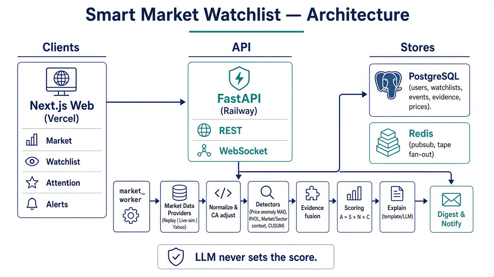

# Smart Market Watchlist

**Groww CODE 2026** — state-aware **attention ranking** for equity watchlists.

> Groww already shows prices. We decide **what deserves attention** after your last check — the smallest novel, trustworthy set — with evidence, and we show what we *refused* to surface. We do **not** predict prices or issue buy/sell advice.

```
ATTENTION = SIGNIFICANCE × NOVELTY × CONFIDENCE
```

| Factor | Meaning |
|--------|---------|
| **Significance** | Unusual vs history + context; **continuous inside** each severity band |
| **Novelty** | New to *this user* at *this event state* (mark-seen collapses until escalation) |
| **Confidence** | Trust in the data (freshness / agreement) — cards show a one-line *why* |

**LLM never sets the score** — it may only narrate verified evidence (optional).

---

## Live demo & video

| | Link |
|--|------|
| **Live app** | [https://groww-watchlist-xi.vercel.app/](https://groww-watchlist-xi.vercel.app/) |
| **Demo video (backup)** | [https://youtu.be/oLnDShTfm5I](https://youtu.be/oLnDShTfm5I) |
| **Source** | [github.com/rajeshwari65/groww_watchlist](https://github.com/rajeshwari65/groww_watchlist) |

**Login:** `demo@example.com` / `DemoPass123!`  
**Data mode:** `MARKET_DATA_MODE=replay` (stable judge story).  
If Mark seen / fetch fails in Chrome, try **Incognito** (extensions can break `fetch`).

---

## For judges (start here)

| # | Doc | Why |
|---|-----|-----|
| 1 | **[docs/DEMO.md](./docs/DEMO.md)** | Live walkthrough (~2–6 min) |
| 2 | **[docs/ARCHITECTURE-OVERVIEW.md](./docs/ARCHITECTURE-OVERVIEW.md)** | System diagram + deploy + engine flow |
| 3 | **[docs/DECISIONS.md](./docs/DECISIONS.md)** | What we considered, deferred, or rejected — and why |
| 4 | **[docs/PROJECT-COMPLETE.md](./docs/PROJECT-COMPLETE.md)** | Full deep dive — math, architecture, features |
| 5 | **[docs/01-PRODUCT.md](./docs/01-PRODUCT.md)** | Problem, formula, non-goals |
| 6 | **[docs/03-FEATURES.md](./docs/03-FEATURES.md)** | What shipped (Tier 1–2) |
| 7 | **[docs/API.md](./docs/API.md)** · **[docs/SECURITY.md](./docs/SECURITY.md)** | HTTP/WS + authz |

**Eval (local):** `cd backend && python -m app.eval` → expect **5/5**.

### Pitch in 20 seconds

1. Watchlist = input (Groww-like curation).  
2. Attention = product (`S · N · C` + **What we ignored**).  
3. HDFC → High (filing + residual + volume); Reliance → suppressed (market-aligned).  
4. Continuous \(S\) differentiates same-tier cards; TCS can show `DATA_CONFLICT`.  
5. Mark seen → novelty memory. Feedback / push / NLP support the thesis — they are not the thesis.

---

## What the app does

| Tab | Purpose |
|-----|---------|
| **Market** | Live-sim tape (demo ticks; not a licensed exchange feed) |
| **Watchlist** | CRUD lists, add/remove names, notes, NLP “describe a watchlist” |
| **Attention** | Ranked digest, headline, ignored-first, evidence, peers, RAG, mark-seen, feedback |
| **Alerts** | Attention-gated in-app notifications |
| **Settings** | Sensitivity + Web Push |
| **Info** | Short product brief for judges |

---

## Stack

| Layer | Choice |
|-------|--------|
| Frontend | Next.js, React, TypeScript, Tailwind (deployed on Vercel) |
| Backend | FastAPI, SQLAlchemy 2, Alembic, Pydantic (API on Railway) |
| Data | PostgreSQL + Redis |
| Analytics | NumPy / Pandas / SciPy — interpretable detectors |
| Local infra | Docker Compose for Postgres + Redis |

Details: [docs/02-TECH-STACK.md](./docs/02-TECH-STACK.md) · Architecture: [docs/ARCHITECTURE-OVERVIEW.md](./docs/ARCHITECTURE-OVERVIEW.md)



---

## Why this shape (and what we deliberately skipped)

We optimized for a **defensible attention wedge**, not a kitchen-sink trading terminal.

- **Shipped:** continuous significance, novelty memory, confidence breakdown, ignored-with-reason, replay demo path, security basics.  
- **Deferred:** Groww Trade API (paid), licensed live feeds, Tier 3 ML (OLS / Isolation Forest / FinBERT), holdings-aware ranking, native mobile.  
- **Rejected:** price prediction, buy/sell tips, LLM-as-scorer, opaque “meaningful move” classifiers.

Full write-up with rationale: **[docs/DECISIONS.md](./docs/DECISIONS.md)**.

---

## Quick start (local)

### Prerequisites

- Docker Desktop (Postgres + Redis), **or** local Postgres/Redis matching `.env`
- Python 3.11+, Node 20+

### Boot

```powershell
cd "path\to\groww - watchlist"
copy .env.example .env   # keep MARKET_DATA_MODE=replay

docker compose up -d postgres redis

cd backend
python -m pip install -r requirements.txt
alembic upgrade head
python -m app.seed
python -m app.demo_pipeline
# or: python -m app.bootstrap_demo
python -m app.eval

python -m uvicorn app.main:app --reload --host 127.0.0.1 --port 8000
```

```powershell
cd frontend
npm install
npm run dev
```

- UI: http://localhost:3000  
- API health: http://localhost:8000/health  
- OpenAPI: http://localhost:8000/docs  

### Tests

```powershell
cd backend
python -m pytest -q
```

---

## Data modes (honesty)

| Mode | Use |
|------|-----|
| **`replay`** (default) | Judge / production demo — seeded session + live-sim tape |
| `yahoo` | Optional delayed NSE quotes via yfinance — **not** the pitch path |
| `live` / `mock` | Live-sim / test providers |

Filings/RAG use a **local demo corpus** (`data/filings/` and `backend/data/` for Docker). Optional LLM: [docs/LLM.md](./docs/LLM.md). Push: [docs/PUSH.md](./docs/PUSH.md).

---

## Non-goals (hard)

- Price prediction / “will rise” models  
- Trading bot / buy-sell recommendations  
- Full RSI/MACD dashboard  
- Ungrounded LLM “analyst” that invents numbers or sets significance  

---

## Docs map

Full index: **[docs/00-INDEX.md](./docs/00-INDEX.md)**

| Path | Purpose |
|------|---------|
| [docs/ARCHITECTURE-OVERVIEW.md](./docs/ARCHITECTURE-OVERVIEW.md) | Architecture diagram + Mermaid |
| [docs/DECISIONS.md](./docs/DECISIONS.md) | Considered / deferred / rejected |
| [docs/DEMO.md](./docs/DEMO.md) | Judge script |
| [docs/PROJECT-COMPLETE.md](./docs/PROJECT-COMPLETE.md) | Complete reference |
| [docs/09-TASKS.md](./docs/09-TASKS.md) | Phase checklist |
| [docs/07-DEVELOPMENT-LOG.md](./docs/07-DEVELOPMENT-LOG.md) | Build diary |
| [docs/08-CHANGELOG.md](./docs/08-CHANGELOG.md) | Notable changes |
