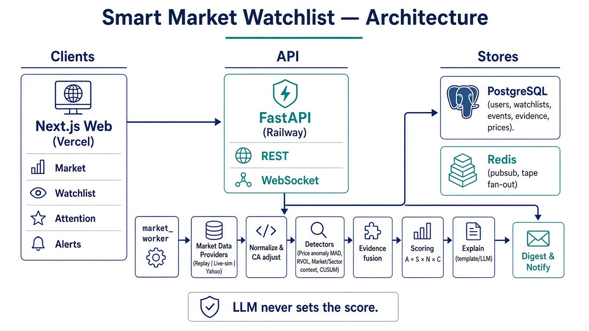
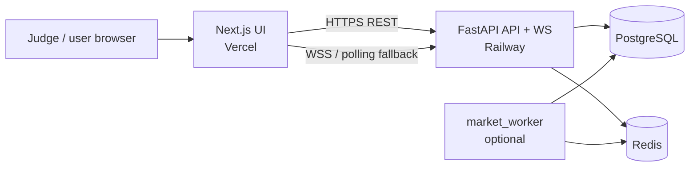
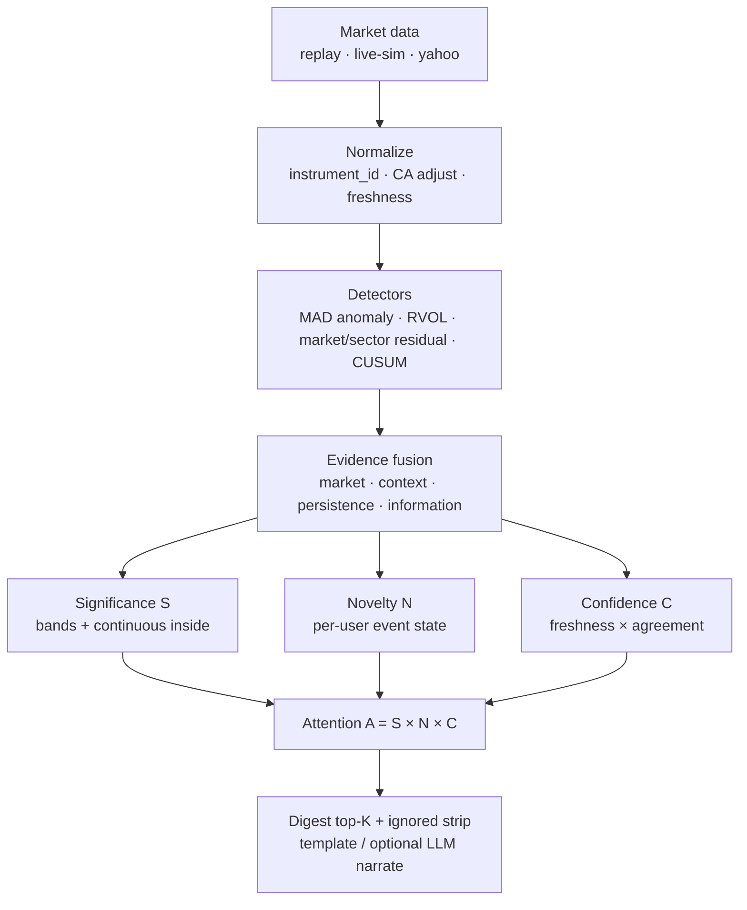
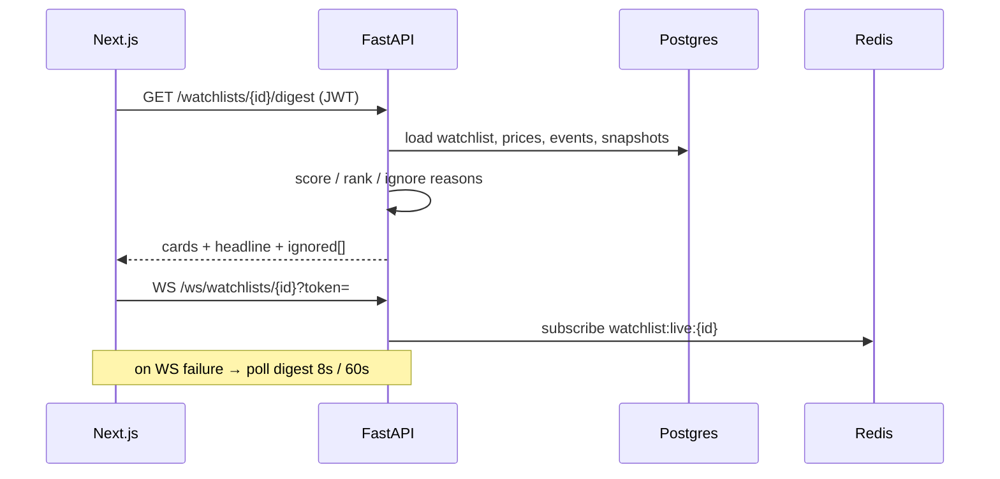

# Architecture overview

**Smart Market Watchlist** — Groww CODE 2026  
One-page view for judges. Deep dive: [05-ARCHITECTURE.md](./05-ARCHITECTURE.md) · Decisions: [DECISIONS.md](./DECISIONS.md)

---

## 1. Deployed shape (what is live)

| Piece | Role |
|-------|------|
| **Vercel** | Static/SSR web UI — [live app](https://groww-watchlist-xi.vercel.app/) |
| **Railway API** | Auth, watchlists, digest, notifications, WebSocket, live-sim tape |
| **Postgres** | Source of truth — users, lists, prices, events, evidence, snapshots |
| **Redis** | Pub/sub fan-out for live updates (not durable truth) |

---

## 2. Attention engine (product core)

**Rule:** the LLM may narrate verified evidence; it **never** assigns \(S\), \(N\), \(C\), or \(A\).

---

## 3. Request path (Attention tab)

---

## 4. Persistence split

| Concern | Store |
|---------|--------|
| Users, watchlists, items, events, evidence, snapshots, price history | **PostgreSQL** |
| Live tape fan-out, pub/sub, hot ephemeral streams | **Redis** |

Identity key is always `instrument_id` (UUID) — never ticker-as-PK.

---

## 5. Repo map (where code lives)

| Path | Responsibility |
|------|----------------|
| `frontend/src/components/` | Market, Watchlist, Attention, Alerts, Settings |
| `backend/app/api/` | REST + WebSocket routes |
| `backend/app/ingestion/` | Providers (replay / live / yahoo), normalize, filings |
| `backend/app/analytics/` | MAD, RVOL, residuals, CUSUM |
| `backend/app/scoring/` | significance, novelty, confidence, attention, fusion |
| `backend/app/services/` | digest, pipeline, auth, notifications, push |
| `backend/app/workers/` | background ingest → score → notify |
| `backend/data/` · `data/` | Replay session + demo filings (Docker ships `backend/data`) |

---

## 6. Data honesty

| Mode | Meaning |
|------|---------|
| **`replay` (default)** | Seeded demo session + in-process live-sim tape — **judge / production demo path** |
| `yahoo` | Optional delayed quotes — not the pitch |
| Filings / RAG | Local demo corpus — architecture ready for a real feed later |

---

## Related docs

- [05-ARCHITECTURE.md](./05-ARCHITECTURE.md) — locked design notes  
- [API.md](./API.md) — endpoints  
- [SECURITY.md](./SECURITY.md) — authz / headers  
- [DECISIONS.md](./DECISIONS.md) — what we deferred or rejected  
